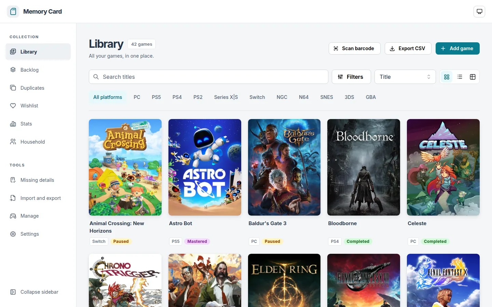

# Memory Card

[![GitHub Release][releases-shield]][releases]
![Project Stage][project-stage-shield]
[![License][license-shield]](LICENSE)

[![GitHub Actions][github-actions-shield]][github-actions]
![Project Maintenance][maintenance-shield]

A video game collection manager that runs as a Home Assistant app. It tracks
the games you own across consoles, the platform and region releases of each
game, and every copy you have, physical or digital.

## Install

Memory Card needs Home Assistant 2026.11 or newer.

1. In Home Assistant, go to **Settings > Apps > Install app**.
2. Open the ⋮ menu, choose **Repositories** and add
   `https://github.com/claudiosanches/ha-memory-card`.
3. Install **Memory Card** and start it. It appears in the sidebar.

[Getting started](docs/getting-started.md) goes through the setup step by
step. Questions and bug reports go to
[GitHub issues](https://github.com/claudiosanches/ha-memory-card/issues).

## Documentation

- [The guide](docs/README.md): every page and feature, with screenshots, and
  the [themes](docs/themes.md).
- [Options](memory-card/DOCS.md): the reference Home Assistant shows in the
  app's **Documentation** tab.
- [Development](docs/development.md), [Local Home Assistant](docs/local-home-assistant.md)
  and [Releasing](docs/releasing.md): building, testing and publishing from
  this repository.

## Credits

- Interface icons from [Tabler Icons](https://tabler.io/icons) (MIT).
- Game metadata and covers from [IGDB](https://www.igdb.com), when IGDB credentials are set.
- Product names for scanned barcodes from [UPCitemdb](https://www.upcitemdb.com).

## License

Memory Card is licensed under the Apache License, version 2.0. See [LICENSE](LICENSE).

[releases-shield]: https://img.shields.io/github/v/release/claudiosanches/ha-memory-card.svg
[releases]: https://github.com/claudiosanches/ha-memory-card/releases
[project-stage-shield]: https://img.shields.io/badge/project%20stage-production%20ready-brightgreen.svg
[license-shield]: https://img.shields.io/github/license/claudiosanches/ha-memory-card.svg
[github-actions-shield]: https://github.com/claudiosanches/ha-memory-card/actions/workflows/ci.yml/badge.svg
[github-actions]: https://github.com/claudiosanches/ha-memory-card/actions/workflows/ci.yml
[maintenance-shield]: https://img.shields.io/maintenance/yes/2026.svg
