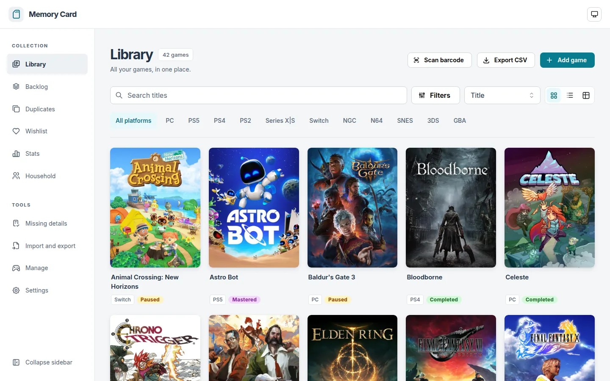

# Memory Card documentation

Memory Card keeps track of the video games a household owns across consoles,
physical or digital, and of what each person plays. It runs as a Home
Assistant app and opens from the sidebar.

The app's **Documentation** tab in Home Assistant is the short reference for
its options. These pages go through everything step by step.

## Start here

- [Getting started](getting-started.md): install the app, name the managers,
  connect IGDB and add your first games.

## Pages

- [Library](library.md): every game, with search, filters and three views.
- [Game page](game.md): details, your progress, releases and copies.
- [Backlog](backlog.md): what you are playing and a random pick.
- [Wishlist](wishlist.md): the copies you want.
- [Duplicates](duplicates.md): games you own more than once.
- [Stats](stats.md): totals for the collection and your play.
- [Household](household.md): everyone's play side by side.
- [Missing details](missing-details.md): fill in what games lack, one at a
  time.
- [Import and export](import-export.md): CSV files and spreadsheets.
- [Manage](manage.md): devices, stores, platforms, play statuses and labels.
- [Settings](settings.md): status, IGDB, appearance and your access.

## Features

- [IGDB](igdb.md): covers and details, sync and close matches.
- [Barcodes](barcodes.md): check a box in a shop and add it.
- [NFC tags](nfc-tags.md): scan a tag on a box to log play.
- [Home Assistant sensors](sensors.md): counts, picks and per-person sensors.
- [Memory Card integration](integration.md): install, the Roll a pick button
  and the roll action.
- [Themes](themes.md): 13 themes, each in light and dark.
- [Data and backups](data.md): where the collection lives.

## Help

Questions, ideas and bug reports go to
[GitHub issues](https://github.com/claudiosanches/ha-memory-card/issues).
For a bug, say which version of Memory Card you run and add the lines around
the problem from the app's **Log** tab.
