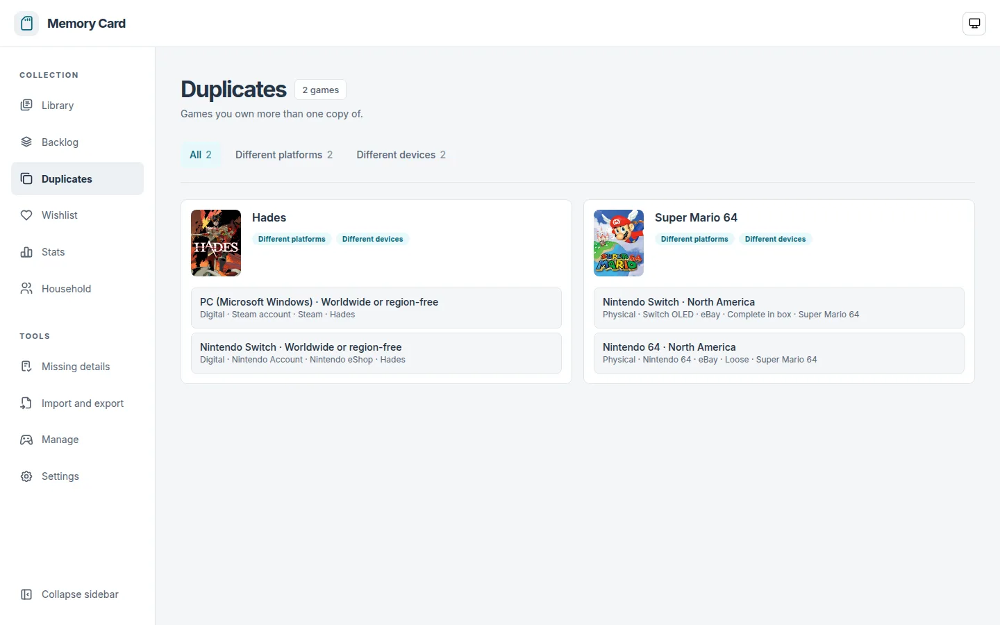

# Duplicates

**Duplicates** in the sidebar lists the games you own more than one copy of,
with every copy and what sets them apart.

The tabs at the top narrow the list by how the copies differ:

- **Same release:** two copies of the same release, such as a spare.
- **Different platforms:** the game on two platforms.
- **Different regions:** two regional releases.
- **Different devices:** copies on two devices or accounts.
- **Physical and digital:** a boxed copy and a digital one.

A game can show under several tabs. Copies on the wishlist are left out.
Only tabs with games show.
