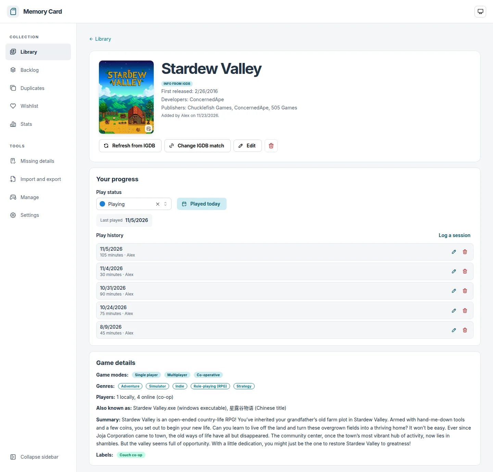

# Game page

Select a game in the [Library](library.md) to open its page. It has four
parts: the header, your progress, the game's details, and its releases and
copies.

## Header

The header shows the cover, the title and, for a game linked to IGDB, its
first release date, developers and publishers. It also says who added the
game and who changed it last.

Managers have these buttons:

- **Refresh from IGDB** fetches the game's details and cover again.
- **Change IGDB match** links the game to another IGDB game; **Link to IGDB**
  when it has none. See [IGDB](igdb.md).
- **Edit** changes the title, the other names under **Also known as**, the
  summary, game modes, player counts and labels.
- The trash button deletes the game with all its copies, and everyone's play
  for it.

To use your own cover, a manager selects the cover and uploads a JPEG, PNG or
WebP image of up to 10 MB and 100 megapixels. IGDB never replaces an uploaded
cover, and removing it brings back IGDB's. Each release can have its own
cover the same way.

## Your progress

This part is yours. Everyone in the house has their own.

- **Play status** puts the game in your [Backlog](backlog.md): backlog,
  playing, paused, completed, dropped, mastered, or a status the managers
  added.
- **Played today** logs a session for today. It says **Logged today** once
  you have one.
- **Last played** shows your latest session.
- **Play history** lists your sessions, newest first. **Log a session** adds
  one with the day, the copy you played and the minutes. The pencil and trash
  buttons edit or delete one.
- **Others in the house** shows each other person's status for the game,
  their number of sessions and when they last played it. It is read-only.

Managers keep their own play. Viewers keep theirs when the app's
`viewers_track_progress` option is on; otherwise they see the household's
play but cannot set their own.

## Game details

Game modes, genres, players on the same screen and online, other names and
the summary come from IGDB or from **Edit**.

**Labels** show after the summary. Selecting one opens the library filtered
by it. Managers create labels under [Manage](manage.md).

**Other versions** lists games in the collection that IGDB calls versions of
this one, such as its remaster, remake, port or another edition. They stay
separate games with their own copies and progress.

## Releases and copies

A release is the game on one platform in one region, such as the North
American Switch release. A copy is one you own or want: physical or digital,
on a device, bought at a store.

Managers add and change them:

1. **Add copy** asks for the platform, region and format, and whether you own
   it (**I own it**) or want it (**On my wishlist**).
2. Fill in what you know: product code, edition, device, where you bought it,
   condition, the day you bought it, the price paid, what it would sell for
   now, the barcode and notes.
3. **Save and add another** keeps the form open for the next copy.

Each release has **Manage release**, to edit its title, product code and
release date or to add another copy of it. Each copy has a pencil button to
edit it and a **⋯** menu:

- **Add photos** keeps photos of the box, the cartridge or the manual. On a
  phone it offers the camera. A copy takes up to 20 JPEG, PNG or WebP photos
  of up to 10 MB each. Memory Card removes the location, camera details and
  other metadata a phone stores in a photo.
- **Add games inside this copy** turns the copy into a bundle, such as a
  collection on one cartridge. Each game inside gets a copy that follows
  this one: change the bundle's platform, region, format, device, store,
  condition or wishlist status and they change too. When the bundle is
  linked to IGDB, Memory Card offers the games IGDB lists in it.
- **Link NFC tag** makes scanning a tag log play for this copy. See
  [NFC tags](nfc-tags.md).
- **Delete copy** removes it. Deleting the last copy asks whether to delete
  the game too.
