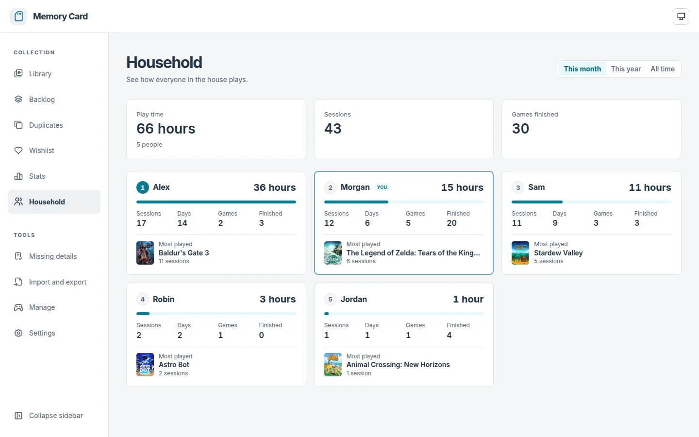

# Household

**Household** in the sidebar puts everyone's play side by side. Everyone in
the house can open it.

Pick **This month**, **This year** or **All time** at the top. The totals
show the household's play time, sessions and games finished in that period.

Below, each person who logged play has a card, the most play time first:

- **Sessions** and **Days** played.
- **Games** they played.
- **Finished:** games they moved to a status that counts as finished in that
  period.
- **Most played:** the game they played most in that period.

Your own card is marked **You**. Names come from Home Assistant, so a person
renamed there shows the new name after their next change in Memory Card.
