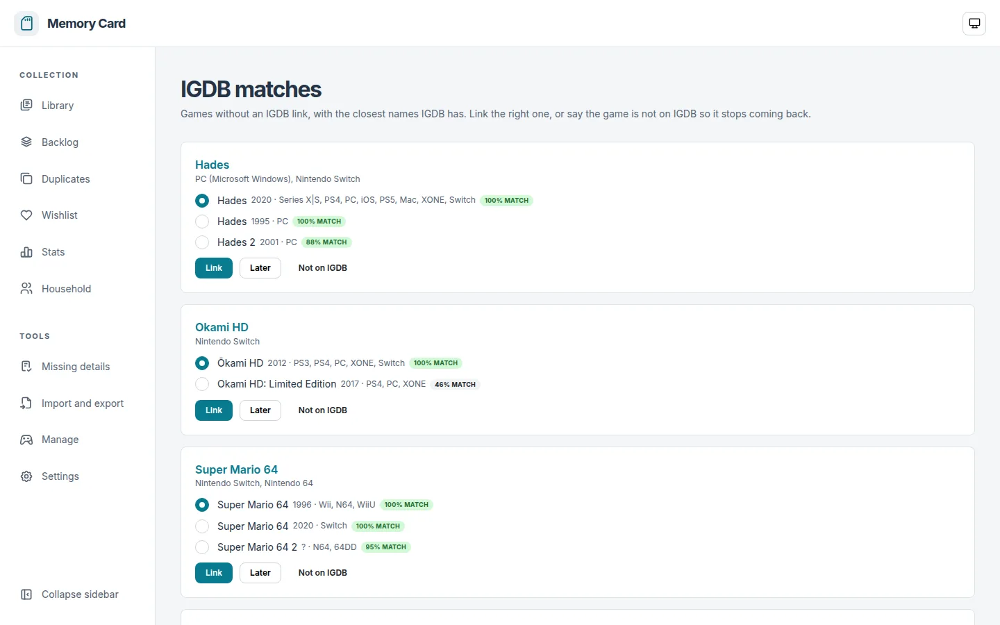

# IGDB

[IGDB](https://www.igdb.com) gives Memory Card titles, covers, release dates,
developers, publishers, genres, game modes, player counts and other names for
each game. Memory Card works without it: you then enter games by hand.
[Getting started](getting-started.md#connect-igdb) explains how to connect
it.

## Link a game

- **Add game** on the [Library](library.md) searches IGDB as you add a game.
- On a [game page](game.md), **Link to IGDB** or **Change IGDB match** searches
  again. Results show the year and platforms of each match, and say which
  games are already in your collection.
- **Refresh from IGDB** on a game page fetches its details again.

Releases for Japan, Korea and Europe get their regional cover when IGDB has
one. An uploaded cover always stays.

When IGDB says two linked games in your collection are versions of each other,
such as a game and its remaster, each game page lists the other under **Other
versions**.

## Sync

**Settings > IGDB > Sync with IGDB** links each game whose title matches
exactly one IGDB game, then updates the details and covers of every linked
game. It shows how many it linked, updated, could not match and failed on.

Under it, **Review game titles** lists linked games whose title differs on
IGDB. **Use IGDB's** takes IGDB's title, **Keep mine** keeps yours, and **Use
IGDB's for all** takes them all. A kept title comes back only if IGDB renames
the game.

## Close matches

**Review close matches**, next to **Sync with IGDB**, lists the games without
an IGDB link with the closest names IGDB has, each with how close it is.

For each game:

- choose the right IGDB game and select **Link**;
- **Later** leaves it for another time;
- **Not on IGDB** stops it coming back, for a game IGDB does not have.

**Show more games** loads the next ones. A game with no close name can still
be linked by hand from its page.

## Staying offline

To keep Memory Card from contacting the internet, turn off the
`external_services` option. The IGDB credentials are then ignored, games,
covers and details are entered by hand, and [barcode](barcodes.md) scans only
check your own copies.
