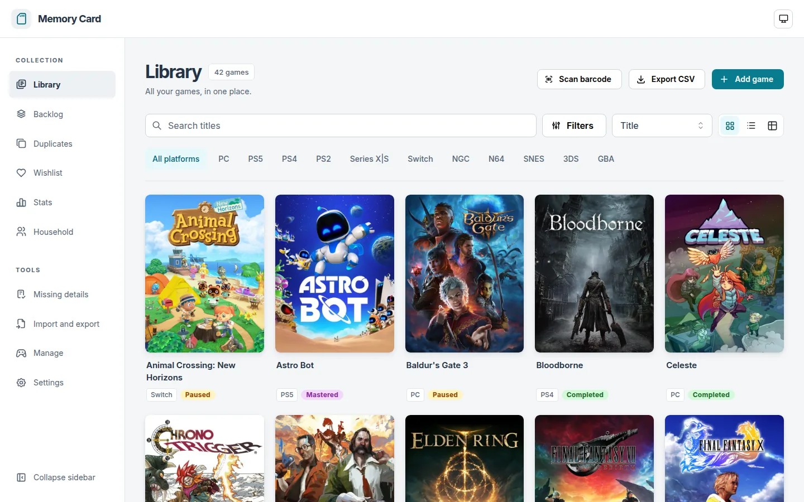

## A look inside

_Game titles and cover art belong to their respective owners._

_Game titles and cover art belong to their respective owners._

## Install

Memory Card needs Home Assistant 2026.11 or newer.

1. Select the button above to add the app's repository to Home Assistant. Or
   go to **Settings > Apps > Install app**, open the ⋮ menu, choose
   **Repositories** and add `https://github.com/claudiosanches/ha-memory-card`.
2. Install **Memory Card** and start it. It appears in the sidebar.

[Getting started](/docs/getting-started) goes through the setup step by step.

## Support development

Memory Card is free and open source. If it is useful to your household, you
can support its development on
[GitHub Sponsors](https://github.com/sponsors/claudiosanches) or
[Ko-fi](https://ko-fi.com/claudiosanches).
