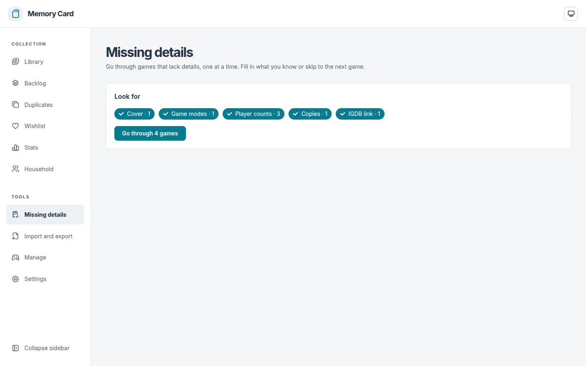

# Missing details

**Missing details** in the sidebar goes through the games that lack details,
one at a time. Only managers see it.

1. Under **Look for**, keep the details you want to fill in and turn off the
   rest. Each shows how many games lack it:
   - **Cover**, **Game modes** and **Player counts**.
   - **Copies:** games with no copies yet.
   - **Device**, **Bought at** and **Condition:** copies that lack them.
   - **IGDB link:** games not linked to IGDB.
2. Select **Go through** to start.
3. Each game shows what it is missing. Fill in what you know, then **Save and
   next**. **Skip** moves on without saving, and **Stop** ends the round.

To upload a missing cover, select the cover. For games with no IGDB link, the
[close matches](igdb.md#close-matches) page is faster.
