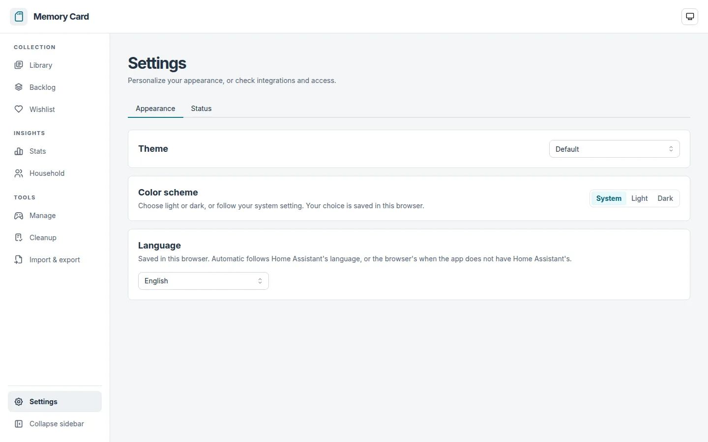

# Settings

**Settings** in the sidebar has three tabs. Everyone can open it.

## Status

**Integrations** says whether each connection works:

- **IGDB:** connected, not configured, or off because external services are
  turned off. See [IGDB](igdb.md).
- **Home Assistant sensors:** connected, waiting for the integration, or what
  stops them. See [sensors](sensors.md).
- **NFC tag scans:** whether Memory Card hears scans from Home Assistant. See
  [NFC tags](nfc-tags.md).

**Your access** shows who you are signed in as, your role and your Home
Assistant user ID. **Copy user ID** copies it, to name a manager in the app's
options or a person for an NFC reader.

**About Memory Card** shows the version, the license, and where to support
development.

## IGDB

Managers see this tab once IGDB is connected. It has **Sync with IGDB**,
**Review close matches** and **Review game titles**. See [IGDB](igdb.md).

## Appearance

Choices here are saved in that browser, so each person and each device keeps
their own.

- **Theme:** one of 13 themes. See [Themes](themes.md).
- **Color scheme:** **System**, **Light** or **Dark**. The button at the top
  right of every page switches it too.
- **Language:** English, Spanish or Brazilian Portuguese. **Automatic** follows
  Home Assistant's language, or the browser's when Memory Card does not have
  Home Assistant's.

Dates follow the language, so English writes 11/23/2026. To write them another
way in every language, set the app's `date_format` option.
