# Themes

Memory Card comes in 13 themes, each with a light and a dark version.

1. Go to **Settings > Appearance**.
2. Choose a **Theme**.
3. Under **Color scheme**, choose **System**, **Light** or **Dark**. The button
   at the top right of every page switches it too.

Both choices are saved in that browser, so each person and each device keeps
their own.

The first five keep to quiet colors and let the covers stand out. The rest
give the whole app a style of its own. Each preview shows the library in light
and dark.

_Game titles and cover art in the previews belong to their respective owners._

## Default

Cool slate with teal accents, blue in the dark.

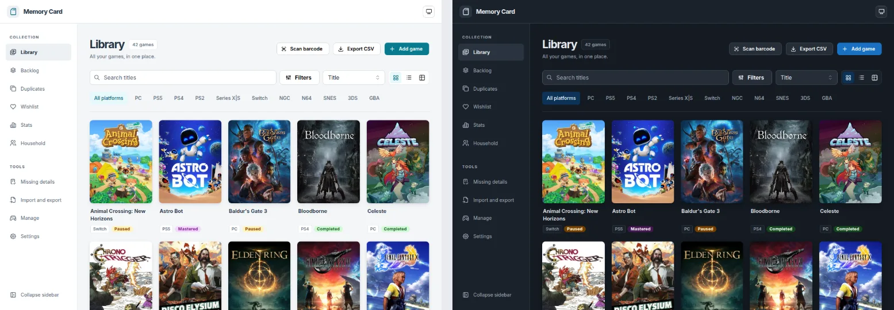

## Monochrome

Black, white and grays with no tint, so the covers bring the color.

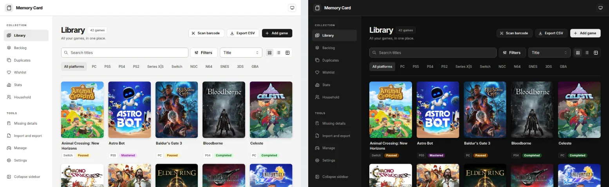

## Warm Stone

Cream and travertine with espresso and sand accents.

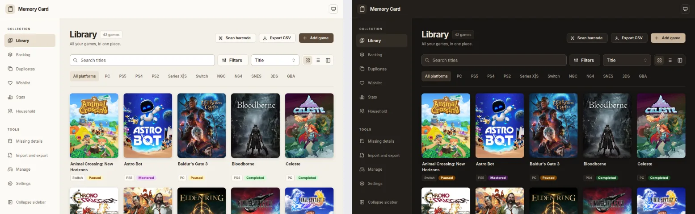

## Slate

Low-glare slate and frost blue, easy on the eyes for long browsing.

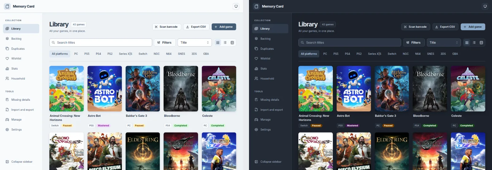

## Sage

Pale mist, or forest charcoal in the dark, with eucalyptus accents.

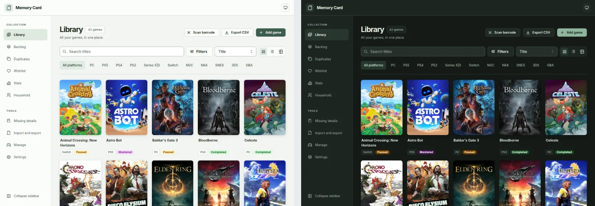

## Retro

An 80s console: parchment or charcoal, faint scanlines, orange and gold
stripes and a pixel-art gamepad.

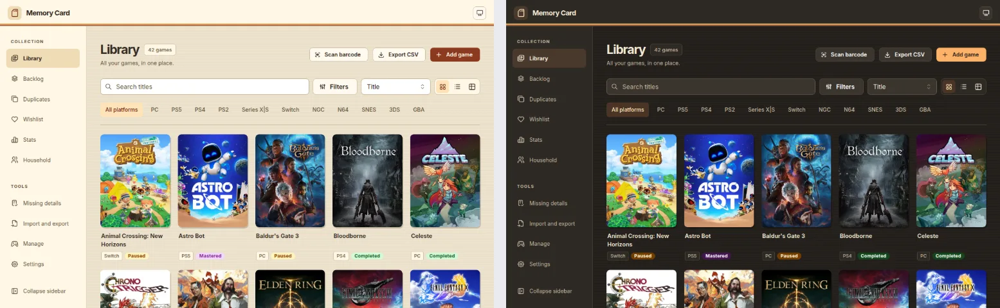

## 2000's Internet

A glossy game portal: enamel blue headers, glass buttons, a starfield and a
spinning globe.

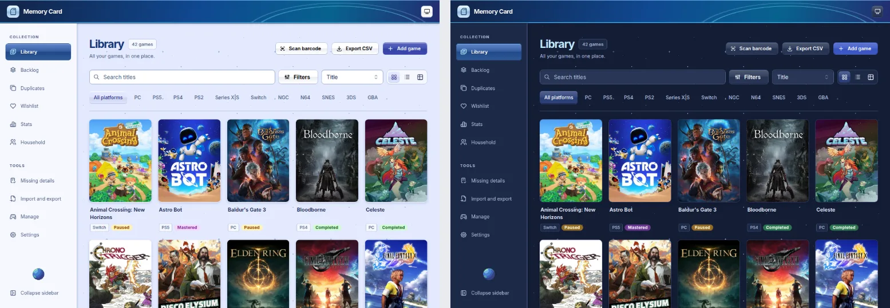

## Steampunk

Vellum and mahogany, serif headings, brass controls, ledger tabs and gears.

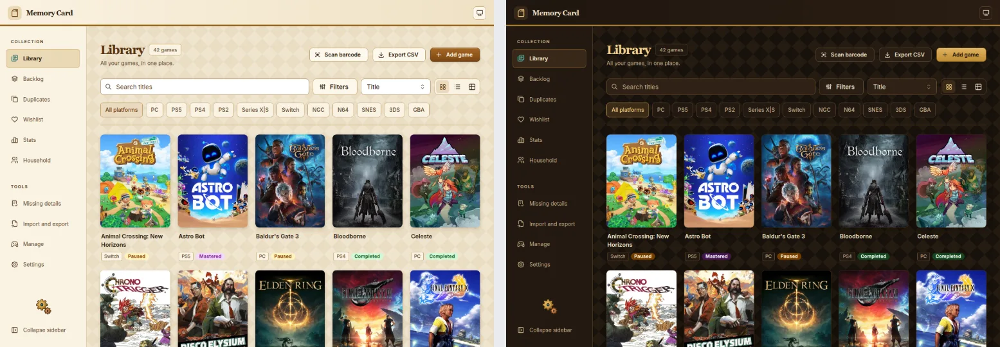

## Dieselpunk

1930s Art Deco: tread-plate steel, sharp corners, uppercase headings, amber
accents and a pressure gauge.

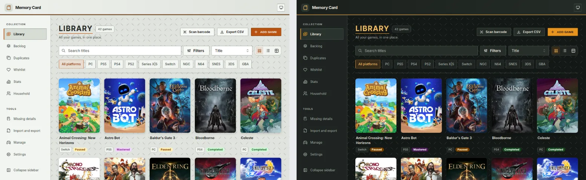

## Cyberpunk

Neon magenta, violet and cyan over a grid, with a city skyline.

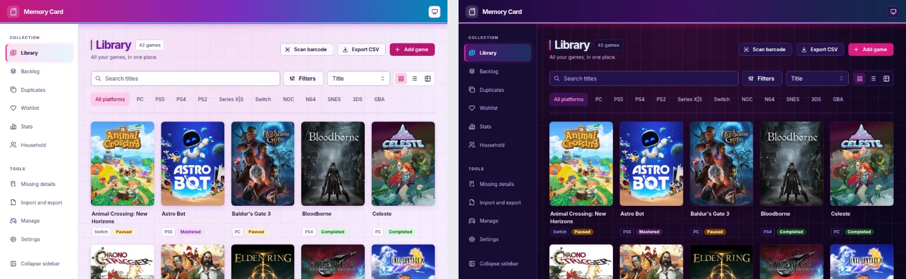

## Circuit

Monospace wireframe: a green dot matrix in light, a phosphor CRT in dark, and
a microchip.

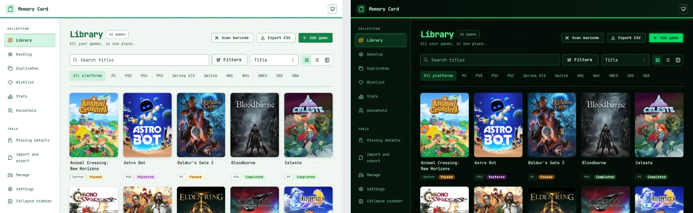

## Pastel Plush

Soft and rounded: strawberry cream with a bunny in light, berry plum with a
teddy bear in dark.

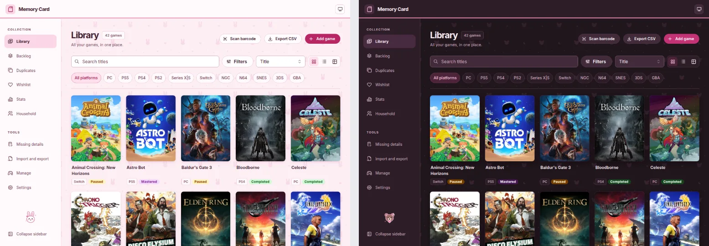

## Cursed 90's

A 1996 home page: square bevels, Tahoma and Courier, a speckled or starfield
background and an Under Construction sign.

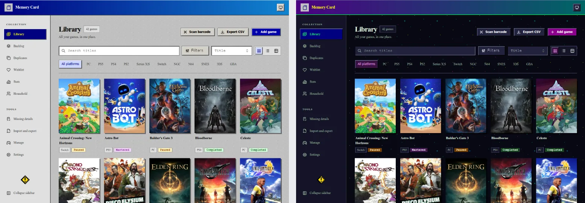
