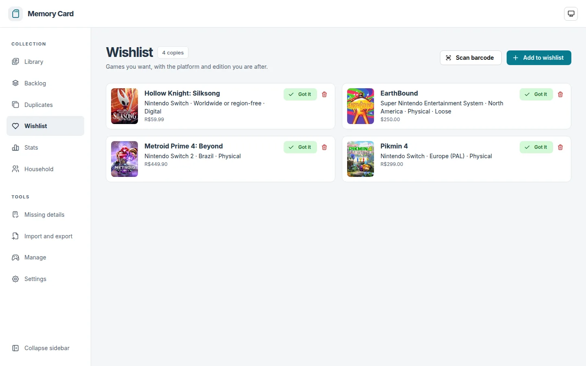

# Wishlist

**Wishlist** in the sidebar lists the copies the household wants, each with
its platform, region, format, where to buy it and the expected price.

_Game titles and cover art belong to their respective owners._

## Add a copy you want

Managers add to the wishlist in two ways:

- **Add to wishlist** on this page asks for the game first. Search IGDB or
  type the title, select **Next**, then fill in the copy: platform, region,
  format, where to buy it and the expected price. When the game is already in
  the collection, the copy goes on that game.
- On a [game page](game.md), **Add copy** with **On my wishlist** chosen.

**Scan barcode** on this page checks a box against the collection, and adds
it to the wishlist when you do not own it. See [Barcodes](barcodes.md).

## When you get it

**Got it** moves the copy into the collection and asks for the device it
lives on, where you bought it and its condition. The trash button removes a
copy from the wishlist.

Wishlist copies do not count as owned anywhere else: the library, backlog,
duplicates and Missing details look only at copies you own. In the
[Library](library.md), **Filters > Show > Wishlist** lists the games on it.
