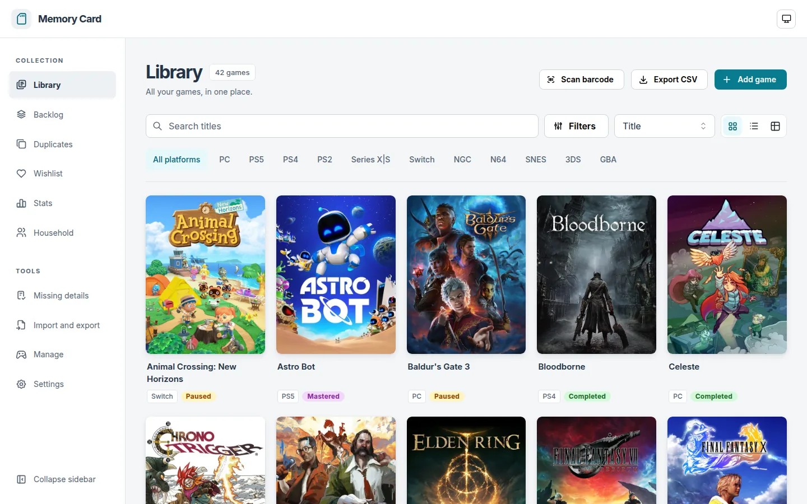
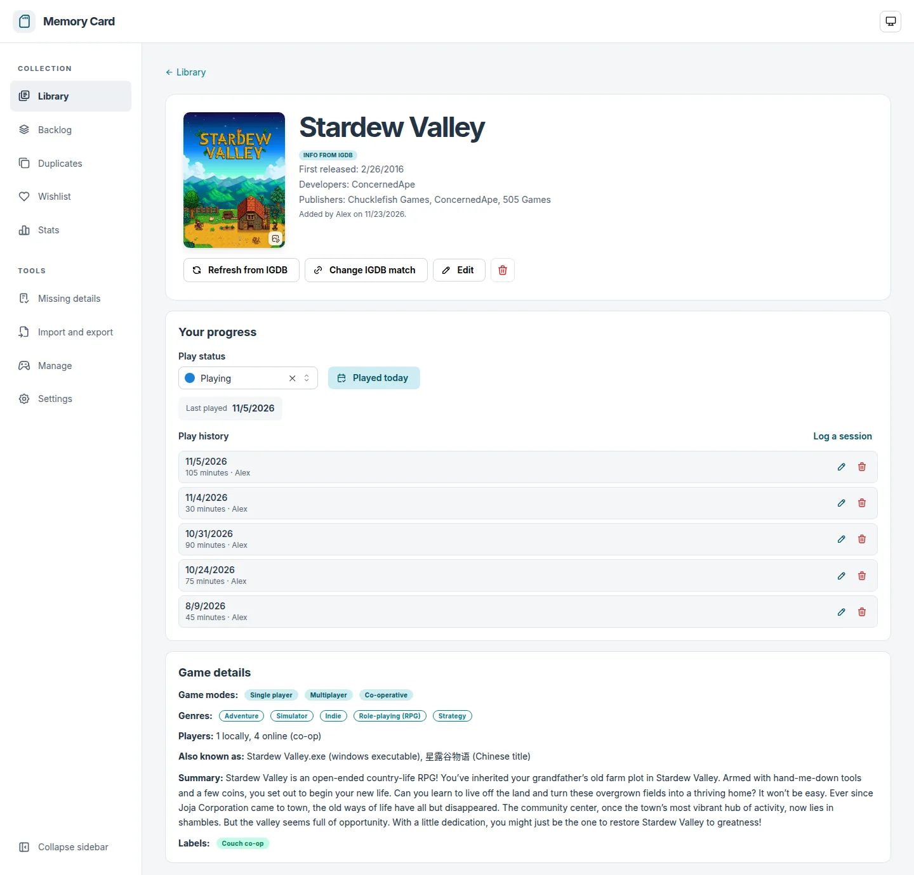
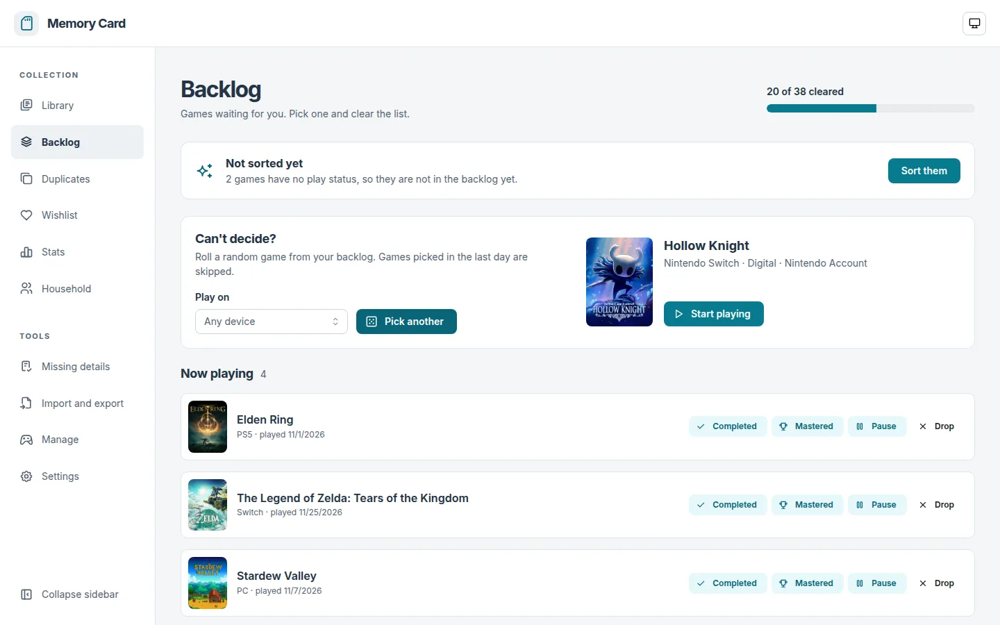
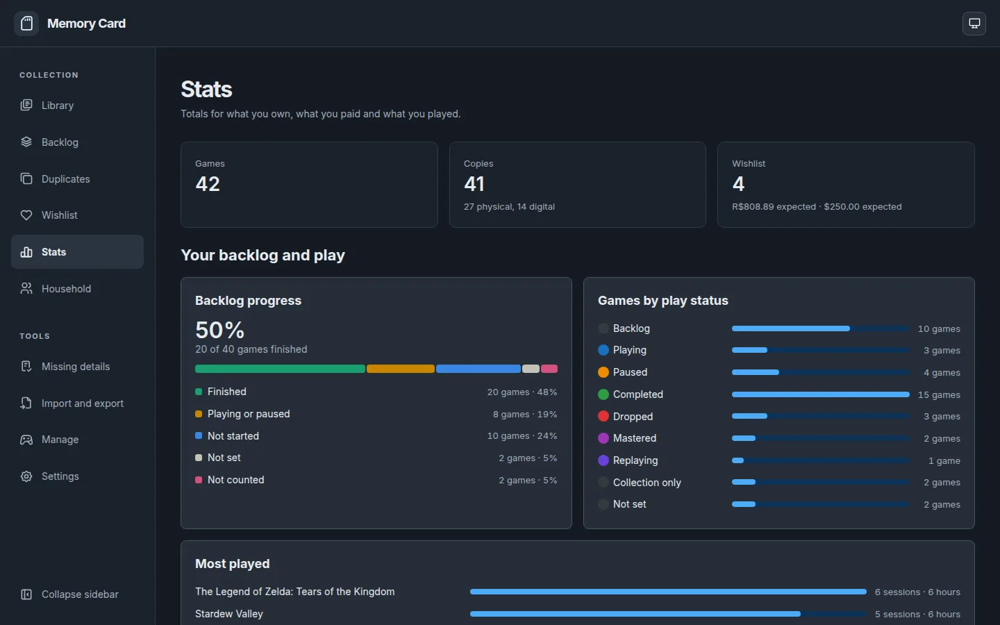

# Memory Card

Memory Card keeps track of the video games you own across consoles, physical
or digital. It opens from the Home Assistant sidebar.



## Installation

1. In Home Assistant, go to **Settings > Apps > Install app**.
2. Open the ⋮ menu, choose **Repositories** and add
   `https://github.com/claudiosanches/ha-memory-card`.
3. Find **Memory Card** in the list, select it and choose **Install**.
4. Start the app. It shows in the sidebar.

A new install is read-only until you name a manager, so do that first. IGDB
credentials are optional; without them you enter games by hand.

## Managers and viewers

Home Assistant signs you in, so Memory Card has no login of its own. Every
Home Assistant user can open it from the sidebar, administrators or not.

Only managers can change the collection. A new install has none, so it
starts read-only. To name a manager:

1. Open Memory Card as that person, go to **Settings** and copy the user ID
   under **Your access**.
2. In Home Assistant, go to **Settings > Apps > Memory Card** and open the
   **Configuration** tab. Add the ID to **Managers**, one entry per manager,
   and save. If the form shows no field for it, choose **Edit in YAML** from
   the ⋮ menu and write:

   ```yaml
   managers:
     - your-user-id
   ```

3. Restart the app from the **Info** tab.

Everyone else is a viewer. Viewers browse the library, game pages, the
backlog and duplicates. They cannot add, edit or delete anything, roll a
random pick, change play progress, import or export CSV files, manage
devices, stores, platforms, play statuses and labels, or sync with IGDB. Requests
that Home Assistant does not tie to a user are refused.

To let viewers keep track of what they play, turn on
`viewers_track_progress`. They can then change play status, log play
sessions and start games from the backlog, but nothing else.

Memory Card keeps the name of each user who adds or changes a game or a
copy, and the game page shows who added it and who changed it last.

## IGDB metadata and covers

The app works without IGDB: you can enter games by hand. To fetch titles,
covers and metadata, give it access to the IGDB API.

1. Enable two-factor authentication on your Twitch account (Twitch requires
   it to register applications).
2. Open the [Twitch developer console](https://dev.twitch.tv/console/apps)
   and register an application:
   - **OAuth Redirect URLs:** `http://localhost`
   - **Category:** Application Integration
   - **Client Type:** Confidential
3. Open the application with **Manage**, copy the **Client ID** and click
   **New Secret** to generate a **Client Secret**.
4. In Home Assistant, open the Memory Card app, go to **Configuration**, fill
   in both fields and save. To keep them in Home Assistant's `secrets.yaml`
   instead, enter `!secret` and the key, such as `!secret igdb_client_secret`.
5. Restart the app. Options are read only at startup.

Releases for Japan, Korea and Europe get their regional cover when IGDB has
one. **Settings > Sync with IGDB** refreshes every linked game.

To keep Memory Card from contacting the internet, turn off
`external_services`. The IGDB credentials are then ignored, games, covers
and details are entered by hand, and barcode scans only check your own
copies.

## Options

Memory Card reads its options when it starts, so restart it after changing
one.

| Option | Description |
|---|---|
| `managers` | Home Assistant user IDs that can change the collection. Empty (the default) leaves it read-only for everyone. |
| `viewers_track_progress` | Lets viewers change play status and log play sessions. Off by default. |
| `external_services` | Lets Memory Card contact IGDB and the barcode database. On by default; IGDB also needs the two credentials below. |
| `igdb_client_id` | Twitch application client ID. Empty disables IGDB. |
| `igdb_client_secret` | Twitch application client secret. |
| `sensors` | `off` (the default), `integration` for the Memory Card integration from the Marketplace, or `mqtt` for the MQTT broker (does nothing without one). See [Home Assistant sensors](#home-assistant-sensors). Going back to `off` removes them. |
| `tag_scan_finished` | What an NFC tag scan does to a completed, dropped or mastered game: `playing` (default) sets it back to playing, `keep` keeps its status and only logs the session. |
| `currency` | Three-letter code, such as `EUR`, that new prices start with. Empty (the default) uses the copy priced last, then Home Assistant's currency. |
| `date_format` | How dates are written: `language` (default) as the app's language writes them, `dmy` as 23/11/2026, `mdy` as 11/23/2026 or `ymd` as 2026-11-23. |
| `log_level` | `trace`, `debug`, `info` (default), `warning` or `error`. |

## Library and games



The library shows your games as a grid of covers, a list or a table. The
filters narrow it by platform, play status, label, genre, game mode, device,
store, region, format and players on the same screen, and they stay in the
address, so a filtered library can be bookmarked. **Show** picks between the
games you own, the wishlist and both.

The library search finds a game by its title, its release titles and its
other names, ignoring case and accents, so `pokemon` finds `Pokémon`.
Linking fills in IGDB's alternative names, such as Japanese titles and
acronyms. Add your own under **Also known as** when editing a game.

When IGDB says two linked games in your collection are versions of each
other, such as a game and its remaster, remake, port or another edition,
each game page lists the other under **Other versions**. They stay separate
games with their own copies and progress. Run a sync to fill this in for
games linked before this was added.

To use your own cover, click the cover of a game or a release on its page and
upload a JPEG, PNG or WebP image of up to 10 MB and 100 megapixels. IGDB
never replaces an uploaded cover. Removing it brings back IGDB's.

## Backlog and play statuses



**Backlog** in the sidebar shows what you are playing, what is on hold and
the games waiting for you, with how many you have cleared. **Pick for me**
rolls a random game from the backlog, for one device if you choose one, and
skips games picked in the last day. Games with no play status wait under
**Not sorted yet** until you give them one.

Manage > Play statuses lists the statuses in the order the app shows them.
The six built-in statuses can be renamed, recolored and reordered, but not
deleted, and their keys never change, so CSV files and integrations can rely
on them. Statuses you add have a name, a color and a "counts as" group:

- Backlog: shown in the backlog grid and picked by "Pick for me".
- Playing and On hold: shown in those sections of the Backlog page.
- Finished: counted as cleared in the backlog progress.
- Not counted: left out of the Backlog page.

Deleting a status moves its games to another status, or leaves them with none.

## Labels

Labels are your own groups for games, such as "Couch co-op" or "Replay
someday". Manage > Labels lists them with how many games have each, and
each has a name and a color. Set a game's labels in its edit form; the game
page shows them after the summary, and selecting one opens the library
filtered by it. The library's Label filter shows games with any of the
labels you pick. Names cannot contain commas or semicolons, which separate
labels in CSV files. Deleting a label keeps its games.

## Wishlist

**Wishlist** in the sidebar lists the copies you want, each with its
platform, region and format. **Add to wishlist** asks for the game first,
then the copy. A copy can also go on the wishlist from a game's page:
choose **On my wishlist** when adding it.

When you get one, **Got it** moves it into your collection and lets you
fill in the device, Bought at and condition. Wishlist copies do not count as
owned anywhere else: the library, backlog, duplicates and Missing details
only look at copies you own. **Show > Wishlist** in the library filters
lists the games on it.

## Barcodes

**Scan barcode** on the Library and Wishlist pages reads the barcode on a
box. When you open Home Assistant over HTTPS, it reads the code live from the
camera. Over plain HTTP, browsers keep the camera from web pages, so it takes
a photo instead. Memory Card reads the code in the browser and first checks
your copies, so in a shop you can see whether you already own a game. When no
copy has the code, it asks [UPCitemdb](https://www.upcitemdb.com) for the
product name, then lets you pick the game and add the copy with the barcode,
platform and region filled in. UPCitemdb allows 100 lookups a day without an
account. With `external_services` off, only your own copies are checked, and
viewers only ever check your copies, so they cannot use up the daily lookups.
If the photo cannot be read, type the digits under the bars instead.

## Photos of copies

To keep photos of a copy, such as the box, the cartridge or the manual,
choose **Add photos** from the copy's **⋯** menu on the game page. On a
phone this offers the camera. Each copy takes up to 20 JPEG, PNG or WebP
photos of up to 10 MB and 100 megapixels each. They are stored with the
app's data, so Home Assistant backups include them. Memory Card removes the
location, camera details, thumbnails and other metadata a phone stores in a
photo, and keeps only which way up it goes and its color profile. Uploaded
covers are cleaned the same way.

## Bundles

A bundle is one copy that holds several games, such as a collection on a
single cartridge. Add the bundle as a game with its copy, then use **Add
games inside this copy** on that copy. When the bundle is linked to IGDB,
Memory Card offers the games IGDB lists in it.

Each game inside gets its own copy, so it shows in the library, the backlog
and duplicates. Those copies follow the bundle copy: change the bundle's
platform, region, format, device, store, condition or wishlist status and
they change too. Price, estimated value and purchase date stay on the bundle
copy. Counts of copies, on the stats page and in the Home Assistant sensors,
count a bundle once. In the CSV, a copy inside a bundle names the
bundle copy's `copy_id` in its `bundle_copy_id` column.

## Import and export (CSV)

**Import and export** in the sidebar downloads your collection as a CSV file
and imports one back. Start from **Download blank template** to enter a
collection in a spreadsheet. **Export CSV** on the Library page downloads
only the copies that match its filters.

After an import, games without an IGDB link can be linked with
**Settings > Sync with IGDB**, which matches them by exact title. **Review
close matches** next to it goes through the rest: it shows IGDB's closest
names for each game, to link with a click or mark as not on IGDB.

- One row per copy you own. A row with only `game_title` (and optionally
  `igdb_id` and `play_status`) adds a game with no copies.
- Column names are not case sensitive and can be in any order. Only
  `game_title` is required in every row; rows with a copy also need
  `platform`, `region` and `format`.
- Files from other spreadsheets work too: common headers such as `Title`,
  `Name`, `System`, `Console`, `Serial`, `UPC`, `Price Paid` or `Comments`
  are recognized. The preview shows how each header was read; pick another
  column for any it read wrong, or leave one out.
- Platform, device and store names match what you already have, ignoring
  case. Common platforms and the digital stores (Nintendo eShop, PlayStation
  Store, Microsoft Store, Steam, Epic Games Store, GOG, itch.io) exist from
  the start. Names that match nothing are created. A new device is an account
  when all its copies are digital, otherwise a console; change it on the
  Manage screen.
- The export fills `copy_id`. Keep it to update that copy when importing the
  file again; leave it empty to add a new copy. Importing an unchanged export
  changes nothing.
- The import shows a preview first. Rows with errors block the import until
  you fix them in the spreadsheet and choose the file again.
- Save the file as CSV UTF-8. Files that use `;` as separator work too.

| Column | Accepted values |
|---|---|
| `copy_id` | Number from the export, or empty |
| `status` | `owned` or `wanted` (empty means owned). `wishlist` is read as `wanted`. |
| `igdb_id` | IGDB game id, optional |
| `game_title` | Required |
| `play_status` | `backlog`, `playing`, `paused`, `completed`, `dropped`, `mastered`, or the name or key of a status you added. Exports write the key. |
| `labels` | Label names, up to 50, separated by commas or semicolons. The import adds them to the game and creates the ones you do not have yet, in gray; it never removes a label. Exports write them separated by `; `. |
| `platform` | Platform name, abbreviation or slug |
| `region` | `na`, `eu`, `au`, `nz`, `jp`, `cn`, `asia`, `kr`, `br`, `ww` (worldwide or region-free); also `NTSC-U`, `PAL`, `NTSC-J` |
| `release_title` | Title on this release, when it differs |
| `product_code` | Serial or product code |
| `format` | `physical` or `digital` |
| `edition` | Free text, such as `Collector's Edition` |
| `device` | Device name |
| `store` | Store name |
| `condition` | Physical only: `sealed`, `cib`, `no_manual`, `loose` |
| `purchased_on` | Date bought, `YYYY-MM-DD` |
| `price` | Price paid, or expected for a wanted copy. `59.99`, `59,99` and `1.299,90` all work; the export writes `1299.90`. Needs `currency`. |
| `currency` | Three-letter ISO 4217 code, such as `USD`, `EUR` or `BRL` |
| `estimated_value` | What an owned copy would sell for now, read like `price`. Uses `estimated_currency`, or `currency` when that is empty. |
| `estimated_currency` | Three-letter code of `estimated_value`, when it differs from `currency` |
| `barcode` | UPC or EAN digits from the box |
| `notes` | Free text |
| `bundle_copy_id` | `copy_id` of the bundle copy this copy came in. Its platform, region, format, device, store, condition and status then follow that copy, and its own price, estimated value and purchase date are left out. Empty takes the copy out of a bundle. |

## Stats



**Stats** in the sidebar sums up the collection: how many games, copies and
wishlist copies you have, your backlog progress and games by play status, the
most played games and a calendar of play activity, copies by platform and by
store, and what you paid next to what your copies are worth now.

## Home Assistant sensors

Memory Card can add a **Memory Card** device to Home Assistant with the
sensors and button below. Pick one of two ways with the `sensors` option and
restart Memory Card. The Status section under Settings in Memory Card says
whether the sensors are connected.

- **`integration`**: the Memory Card integration, installed from the
  Marketplace. No broker is needed.
  1. Add the
     [Memory Card integration](https://my.home-assistant.io/redirect/marketplace_repository/?owner=claudiosanches&repository=ha-memory-card-integration&category=integration)
     to the Marketplace as a custom repository, which needs the Marketplace
     connected to GitHub. Download it and restart Home Assistant.
  2. Set `sensors` to `integration` and restart Memory Card.
  3. Under **Settings > Devices & services**, Home Assistant shows Memory
     Card as discovered. Select **Add**.
- **`mqtt`**: MQTT discovery. It needs the **Mosquitto broker** app and the
  **MQTT** integration, which Home Assistant offers to set up once the broker
  runs. Start Memory Card after the broker so it finds it.

Both create the same entities with the same IDs. Switching from one to the
other removes the old ones on the next start, so history graphs carry on.

| Entity | State | Attributes |
|---|---|---|
| `sensor.memory_card_games` | Games with at least one owned copy | |
| `sensor.memory_card_copies` | Owned copies | |
| `sensor.memory_card_wishlist` | Copies on the wishlist | |
| `sensor.memory_card_backlog` | Owned games in a status that counts as backlog | |
| `sensor.memory_card_playing` | Owned games in a status that counts as playing | `games`: their titles, last played first |
| `sensor.memory_card_last_played` | Title of the game with the latest play session | `date`, `platform` of the copy played |
| `sensor.memory_card_last_added` | Title of the game whose owned copy was added last | `added_at`, `platform` |
| `sensor.memory_card_pick` | Title of the latest random pick, from Memory Card or Home Assistant | `suggested_at`, `platforms` of its owned copies |
| `button.memory_card_roll_pick` | Picks a random owned game from the backlog, as **Pick for me** on the Backlog page does | |

An automation can roll with filters, for example a game for two on the
Switch:

- with the integration, the `memory_card.roll_pick` action with
  `device: [switch]` and `min_local_players: 2`. It responds with the
  picked game's `title` and `platforms`.
- with MQTT, the `mqtt.publish` action sending
  `{"device": ["switch"], "min_local_players": 2}` to `memory_card/pick/roll`.

Rolls need managers set in the options. With the integration, a person who
rolls must also be one of them; an automation needs nothing more. MQTT can't
tell who pressed the button, so there anyone who can press it rolls.

The fields match the Backlog page's picker: `play_status` (a list of play
status keys), `platform`, `device`, `genre`, `game_mode` (lists of slugs)
and `min_local_players`. Each platform, device and store shows its slug in
its Manage form, and library links use the same slugs.

The counts keep long-term statistics, so history graphs show how the
collection grows. Sensors update a second after each change and show as
unavailable while Memory Card is stopped. Setting the `sensors` option back
to `off` removes the device on the next start.

## NFC tags

Put an NFC tag on a game's box, and scanning it with the Home Assistant
companion app starts that copy: Memory Card logs a play session for today
and sets the game to playing. To link a tag, choose **Link NFC tag** from the
copy's **⋯** menu on the game page, then scan the tag within a minute. Any
tag Home Assistant reports works, including ones written under **Settings >
Tags** in Home Assistant.

A scan logs play for managers, and for viewers when `viewers_track_progress`
is on. A reader with no Home Assistant user, such as an ESPHome NFC reader,
counts as a viewer, and nothing is logged while no managers are set. A link
waits for a scan by the manager who started it or by a reader with no user.

Pages open in Memory Card show a scan within a second, like any change
someone else makes. Scanning the same tag again on the same day does not add
another session.
A game whose status counts as finished goes back to playing too, unless the
`tag_scan_finished` option is set to `keep`.
Memory Card hears scans through the Home Assistant API, which is why the app
asks for access to it; the Status section under Settings says whether it is
listening. **Unlink NFC tags** in the same menu removes a copy's tags.

## Language and currency

Memory Card comes in English, Spanish and Brazilian Portuguese. It follows
Home Assistant's language, or your browser's when Home Assistant uses one
the app does not have. To pick one, go to **Settings > Appearance >
Language**; the choice is saved in that browser. The app's options in Home
Assistant are translated too.

Dates follow the language, so English writes 11/23/2026. To write them
another way in every language, set the `date_format` option.

New prices start in the `currency` option when it is set, else in the
currency of the copy priced last, else in Home Assistant's currency.

Memory Card reads Home Assistant's language and currency once after it
starts. Restart the app after changing either of them in Home Assistant.

## Data and backups

Everything the app stores lives in the app's data folder, which Home Assistant
includes in its backups:

- `db/memory-card.sqlite`: your collection.
- `db/pre-migration/`: a copy of the database taken before each upgrade that
  changes its structure. The last five are kept.
- `covers/`: downloaded and uploaded covers, and photos of copies.

Backups stop the app for a moment so the database is copied in a consistent
state. The app starts again on its own when the backup finishes.

## Support

Questions, ideas and bug reports go to
[GitHub issues](https://github.com/claudiosanches/ha-memory-card/issues).
For a bug, say which version of Memory Card you run and add the lines around
the problem from the app's **Log** tab.

To support development, use
[GitHub Sponsors](https://github.com/sponsors/claudiosanches) or
[Ko-fi](https://ko-fi.com/claudiosanches).
